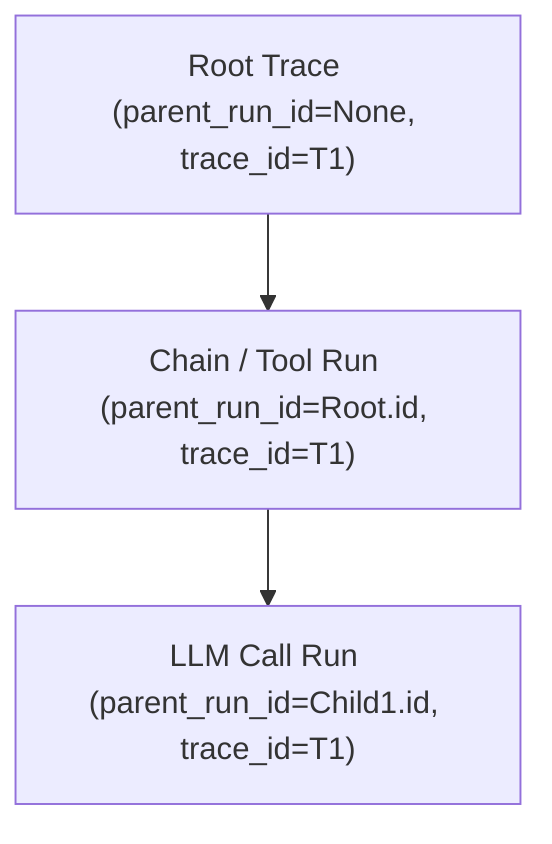

# Project Context: fastapi-agent-observability

> **MANDATORY INSTRUCTION FOR AGENTS**: Refer to this document before implementing, modifying, or fixing any feature. All code changes must align with the scope, requirements, and invariants outlined below.

---

## 1. Project Purpose & Scope

`fastapi-agent-observability` is an embeddable, local-first observability, execution tracing, and telemetry dashboard designed for FastAPI applications powering AI agents (specifically LangChain, LangGraph, and manual instrumentation).

### In-Scope:
- **Embeddable Mount**: Mounts cleanly inside an existing FastAPI host app via `obs.mount(app)`.
- **Host-Delegated Auth**: Completely offloads authentication (`get_current_user`) and authorization (`is_admin`) to the host app.
- **Hierarchical Traces**: Captures multi-step parent-child execution spans (`chain`, `tool`, `llm`, etc.) with inputs, outputs, errors, and latencies.
- **Callback Integration**: First-class optional support for `langchain-core` callbacks (`get_langchain_callback(obs)`).
- **Manual Instrumentation**: Clean context manager (`with obs.tracer.start_run(...)`) and decorator (`@obs.tracer.trace(...)`).
- **Server-Rendered UI**: Lightweight Jinja2 + HTMX dashboard mounted at a configurable prefix (default: `/admin/observability`).
- **Local-First Storage**: SQLite default with cross-thread concurrency safety (`check_same_thread=False`); PostgreSQL supported via SQLAlchemy 2.0 with `postgres` extra.
- **Safe Payloads**: Best-effort truncation of inputs and outputs up to `max_payload_chars` (default 12,000, minimum 256) to protect database memory.
- **Fail-Safe Telemetry**: Errors in tracing/persistence must never crash or interfere with the host application's core logic.

### Out-of-Scope (Do NOT implement):
- **Independent Login/Auth**: Do NOT build authentication tables, login pages, session cookies, OAuth client flows, or password hashing.
- **Heavy Client SPAs**: Do NOT introduce React, Vue, Angular, or complex JavaScript build pipelines. UI remains Jinja2 + HTMX.
- **Raw PII & Credential Storage**: Do NOT log plaintext credentials, API keys, or raw PII in database payloads.

---

## 2. Core Functional Requirements

| Requirement | Implementation Detail | Invariant |
| :--- | :--- | :--- |
| **Authentication** | `Depends(self.get_current_user)` | Delegate completely to host. If host dependency raises 401/redirects, let it propagate. |
| **Authorization** | `self.is_admin(user)` | May return a sync boolean or an awaitable boolean (`inspect.isawaitable`). Non-admins receive `403 Forbidden`. |
| **Context Propagation** | `contextvars.ContextVar` | Active run ID and trace ID tracked across async execution contexts (`_current_run_id`, `_current_trace_id`). |
| **Payload Truncation** | `_json(payload, max_chars)` | Strict payload cap with ellipsis truncation: `... [truncated]`. |
| **Database Transactions** | Context-managed sessions | `with self.database.session() as session: ...` with automatic commit and rollback. |
| **Best-Effort Telemetry** | Silent containment in tracer | Exceptions in `_persist_start` and `_persist_finish` are suppressed to ensure business continuity. |

---

## 3. Technology Stack

- **Python**: `>= 3.10` (Modern typing, `str | None`, `collections.abc`)
- **Web Framework**: `FastAPI >= 0.110`, `Starlette >= 1.8`
- **Database ORM**: `SQLAlchemy >= 2.0`
- **Frontend / Templating**: `Jinja2 >= 3.1`, `HTMX 2.0` (CDN with offline vendoring capability)
- **Optional Extras**:
  - `langchain`: `langchain-core >= 0.2`
  - `postgres`: `psycopg[binary] >= 3.1`
  - `dev`: `pytest >= 8.0`, `httpx >= 0.27`, `ruff >= 0.5`
- **Build System**: `hatchling`

---

## 4. Key Architectural Patterns

### Trace Hierarchy Model:

### Storage Schema (`observability_runs`):
- `id` (String 36, PK)
- `trace_id` (String 36, Indexed)
- `parent_run_id` (String 36, Nullable, Indexed with started_at)
- `name` (String 255)
- `run_type` (String 50: `chain`, `tool`, `llm`)
- `status` (String 20: `running`, `success`, `error`)
- `started_at` / `ended_at` (DateTime with timezone)
- `latency_ms` (Float)
- `inputs_json` / `outputs_json` (Text, truncated)
- `error` (Text, truncated)
